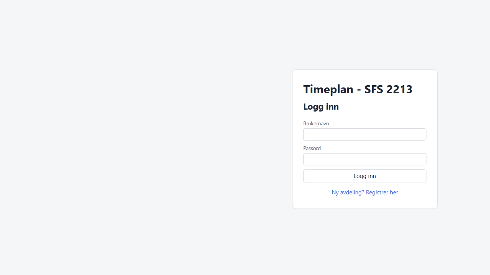
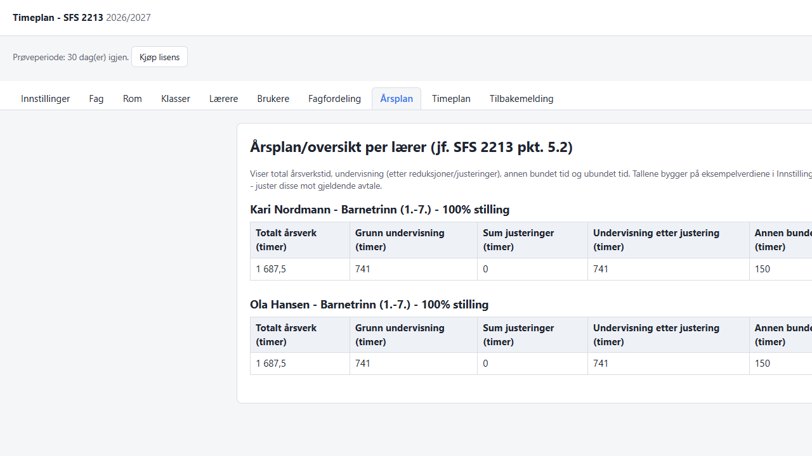
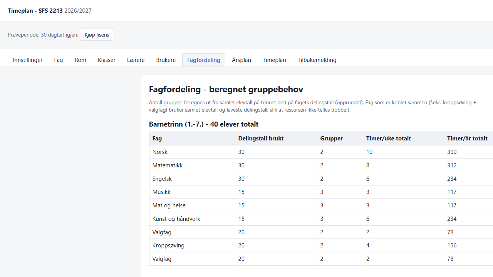
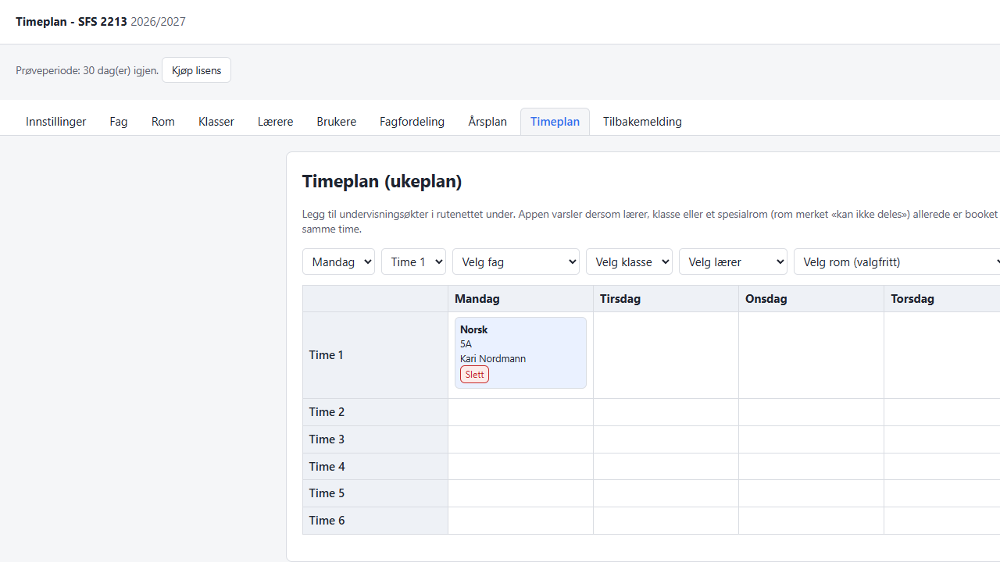

# Timeplan - årsplan/timeplanverktøy (SFS 2213)

[](https://github.com/torbjorc-web/timeplan/actions/workflows/ci.yml)

Verktøy for avdelingsleder til å lage årsplan og ukentlig timeplan for undervisningspersonale, basert på strukturen i SFS 2213. Multi-tenant webapp (flere skoler/avdelinger, hver med egne data), med roller for avdelingsleder, lærer, rektor og en global superadmin.

Frontend: Vite + React + TypeScript (repo-rot). Backend: Node.js + Express + TypeScript (`/server`), fil-basert JSON-lagring.

## Skjermbilder

| Innlogging | Årsplan |
| --- | --- |
|  |  |

| Fagfordeling | Timeplan |
| --- | --- |
|  |  |

## Oppsett

```powershell
# Frontend-avhengigheter (repo-rot)
npm install

# Backend-avhengigheter
cd server
npm install
cd ..
```

## Miljøvariabler (server/.env)

Opprett `server/.env` (ikke commit denne filen - den er i `.gitignore`):

```env
JWT_SECRET=en-lang-tilfeldig-hemmelig-streng
STRIPE_SECRET_KEY=sk_test_...
STRIPE_WEBHOOK_SECRET=whsec_...
STRIPE_PRIS_ID=price_...
APP_URL=http://localhost:5173
```

- `JWT_SECRET` er **påkrevd i produksjon** (`NODE_ENV=production`). I utvikling brukes en innebygd standardverdi hvis den mangler.
- Stripe-variablene er kun nødvendig for å teste/bruke "Kjøp lisens"-knappen og lisens-webhooken. Uten dem gir betalingsrutene en tydelig 503-feil, resten av appen fungerer som normalt (nye avdelinger får 30 dagers prøveperiode automatisk).
- **Vipps er ikke implementert.** Dette krever en signert Vipps-merchant-avtale og egne sertifikater/klient-ID som ikke kan settes opp uten dine egne Vipps-credentials. Legg det til senere via Vipps sitt ePayment-API når avtalen er på plass - samme mønster som Stripe-integrasjonen (egen rute + webhook som oppdaterer `tenant.lisensstatus`).

### Sette opp Stripe lokalt

1. Opprett et produkt/abonnement i [Stripe Dashboard](https://dashboard.stripe.com/) (test-modus), kopier pris-ID-en til `STRIPE_PRIS_ID`.
2. Bruk [Stripe CLI](https://stripe.com/docs/stripe-cli) til å videresende webhooks lokalt: `stripe listen --forward-to localhost:3001/api/betaling/webhook`. CLI-en gir deg en `whsec_...`-verdi til `STRIPE_WEBHOOK_SECRET`.

## Opprette superadmin-bruker

Superadmin er en global konto (ser alle skoler, innlogginger og tilbakemeldinger, kan frigi/sperre lisenser) og kan **ikke** opprettes via registreringsskjemaet i appen. Kjør i stedet:

```powershell
cd server
npm run create-superadmin
```

Scriptet spør om brukernavn, navn og passord i terminalen.

## Kjøre i utvikling

Kjør frontend og backend samtidig fra repo-rot:

```powershell
npm run dev:full
```

Dette starter Vite dev-server (`http://localhost:5173`) og Express-serveren (`http://localhost:3001`) samtidig. Vite er satt opp med proxy slik at `/api/*`-kall fra frontend videresendes til backend automatisk.

Alternativt, i to separate terminaler:

```powershell
npm run dev            # frontend
npm run dev:server     # backend
```

## Bygge for produksjon

```powershell
npm run build           # bygger frontend til dist/
cd server
npm run build           # kompilerer backend til server/dist/
npm start                # kjører den bygde serveren, serverer også frontend fra ../dist
```

Serveren kjører på samme origin for både API og statiske filer i produksjon (unngår CORS).

## Testing og CI

Både frontend og backend har et minimum av Vitest-tester for kjernelogikken (beregninger, lisensvalidering, rollebasert tilgangskontroll):

```powershell
npm run test              # frontend (utils/calculations)
cd server
npm run test              # backend (store, middleware)
```

GitHub Actions ([`.github/workflows/ci.yml`](.github/workflows/ci.yml)) kjører lint, tester og build for begge prosjekter automatisk på push/PR mot `master`.

### Coverage-rapport

```powershell
npm run test:coverage         # frontend
cd server
npm run test:coverage         # backend
```

CI-jobbene kjører også `test:coverage` og laster opp HTML/LCOV-rapporten som en artifact på hver kjøring (se "Artifacts" på jobb-siden i GitHub Actions).

## Deploy (live-demo)

Appen kjøres som **to separate tjenester**: backend-API-et (`server/`) på Render, og det statiske frontend-bygget på Netlify. De kommuniserer over CORS med cookie-basert innlogging (`credentials: 'include'`), så begge URL-ene må vite om hverandre.

**Backend (Render)** - repoet har et [Render Blueprint](https://render.com/docs/blueprint-spec) (`render.yaml`):

1. Logg inn på [Render](https://dashboard.render.com/), velg **New +** → **Blueprint**, og koble til dette repoet.
2. Render leser `render.yaml` og oppretter én web-tjeneste (kun API, ingen frontend) med riktig build-/start-kommando.
3. Sett miljøvariablene som er markert `sync: false` i Render-dashbordet: `APP_URL` til Netlify-URLen til frontend (brukes til CORS og Stripe-redirects), samt `STRIPE_*` hvis betaling skal testes. `JWT_SECRET` genereres automatisk av Render.

**Frontend (Netlify)** - repoet har `netlify.toml`:

1. Logg inn på [Netlify](https://app.netlify.com/), velg **Add new site** → **Import an existing project**, og koble til dette repoet.
2. Netlify plukker opp `netlify.toml` automatisk (build-kommando `npm ci && npm run build`, publiserer `dist/`).
3. Sett miljøvariabelen `VITE_API_URL` i Netlify (Site configuration → Environment variables) til Render-tjenestens URL, f.eks. `https://timeplan-s5xh.onrender.com`.
4. Redeploy siden env-variabelen brukes ved bygging (Vite bygger den inn i bundlet, den leses ikke ved kjøretid).

**Stripe er valgfritt.** Er `STRIPE_*`-variablene tomme, starter appen likevel - betalingsrutene svarer da med en tydelig 503-feil i stedet for å krasje serveren. Sett dem når du er klar til å teste betalingsflyten.

**Viktig: JSON-fillagring og persistens.** Render sine gratis web-tjenester har **ikke** persistent disk - filene i `server/data/` (avdelinger, brukere, skoledata) nullstilles ved hver redeploy og ved periodisk restart av gratis-instanser. Dette er greit for en midlertidig live-demo, men **ikke egnet for faktisk produksjonsbruk**. For å beholde data må du enten:

- Oppgradere til et betalt Render-plan og legge til en disk i `render.yaml` (kommentert eksempel ligger i filen), eller
- Migrere lagringen fra JSON-filer til en ekte database (SQLite/Postgres) - se begrunnelsen for dagens valg og videre planer i seksjonen [JSON-fillagring](#json-fillagring) under.

## JSON-fillagring

Serveren lagrer alle data (avdelinger, brukere, skoledata, innloggingslogg, tilbakemeldinger) som JSON-filer under `server/data/`, med enkel per-fil skrivelås (`jsonStore.ts`) for å unngå korrupte filer ved samtidige skriv. Dette er et bevisst valg for et internt verktøy i tidlig fase: ingen ekstra database-oppsett/drift, enkelt å inspisere og sikkerhetskopiere data manuelt, og "godt nok" ytelse for antallet avdelinger/brukere verktøyet er laget for.

Kjente begrensninger ved denne løsningen:

- Ingen persistens på plattformer med ephemeral filsystem (se Deploy-seksjonen over).
- Skalerer ikke til flere samtidige server-instanser (per-fil-låsen er kun i minnet til én prosess).
- Ingen transaksjoner på tvers av flere filer.

**Neste steg hvis behovet vokser:** migrere til SQLite (enkelt, fortsatt fil-basert, men med ekte transaksjoner og indeksering) eller Postgres (for flere instanser/skalering), bak samme funksjonsgrensesnitt som i dag (`store.ts`) - resten av appen (ruter, middleware) trenger ikke endres.

## Roller

| Rolle | Tilgang |
| --- | --- |
| avdelingsleder | Full lese/skrive-tilgang til egen avdelings data, oppretter lærer-/rektor-kontoer, kjøper lisens |
| laerer | Kun lesetilgang til egen årsplan/timeplan |
| rektor | Kun lesetilgang til hele avdelingens data |
| superadmin | Global oversikt over alle skoler, innloggingslogg, tilbakemeldinger, kan frigi/sperre lisenser |

## Lisens/prøveperiode

Nye avdelinger som registrerer seg får 30 dagers prøveperiode med full tilgang. Etter det må avdelingsleder kjøpe lisens (Stripe Checkout) eller vente på at superadmin frigir tilgangen manuelt. Superadmin kan når som helst sperre eller frigi en avdeling fra admin-panelet, uavhengig av Stripe-status.

## Funksjoner

- Årsplan/timeplan-beregning etter SFS 2213-struktur (justerbare eksempelverdier, ikke fasit-tall - kontroller mot gjeldende avtale i Innstillinger)
- Praktisk-estetiske fag med egne delingstall, kobling Kroppsøving+valgfag
- Individuelle justeringer per lærer (kontaktlærer, tillitsvalgt, seniortiltak, annet)
- Ukentlig timeplan med konfliktsjekk for rom/lærer/klasse
- CSV-eksport (Excel-vennlig) for årsplan og timeplan
- Installerbar som PWA (app-lignende opplevelse i nettleser, uten Electron/React Native)
- Tilbakemeldingsboks til superadmin fra avdelingsledere

## Lisens (kildekode)

Denne koden er proprietær - se [LICENSE](LICENSE). Repoet er offentlig synlig, men koden kan kun brukes av rettighetshaver eller de som har fått uttrykkelig tillatelse.
